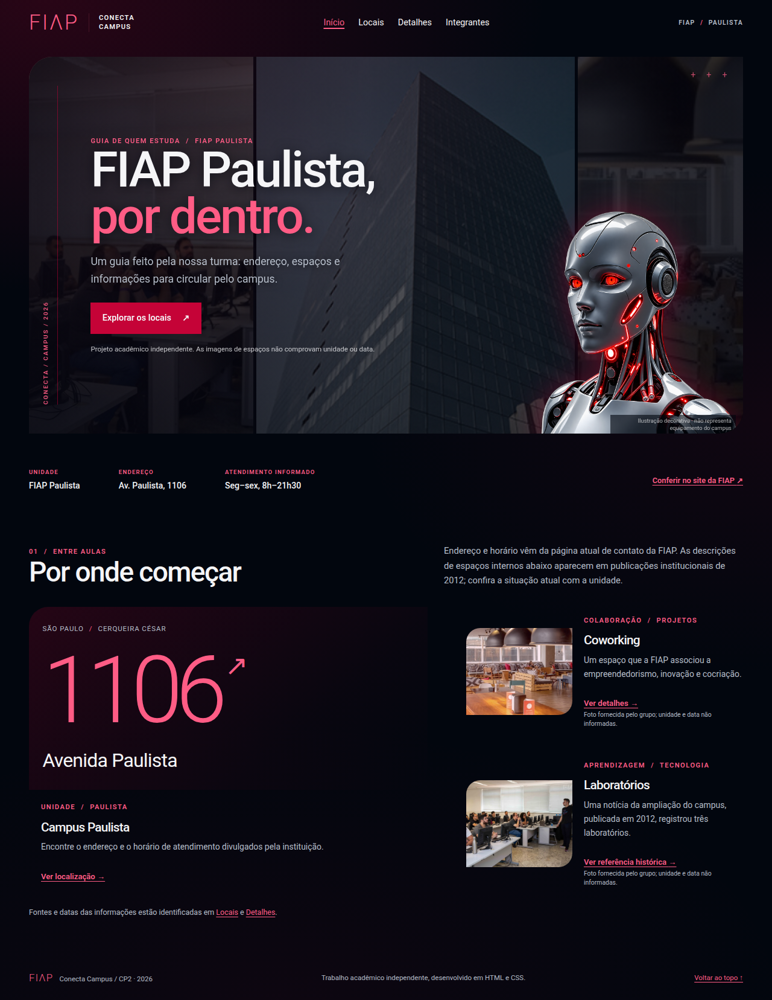
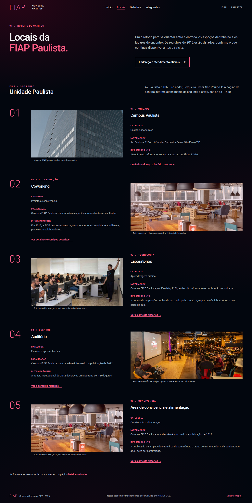
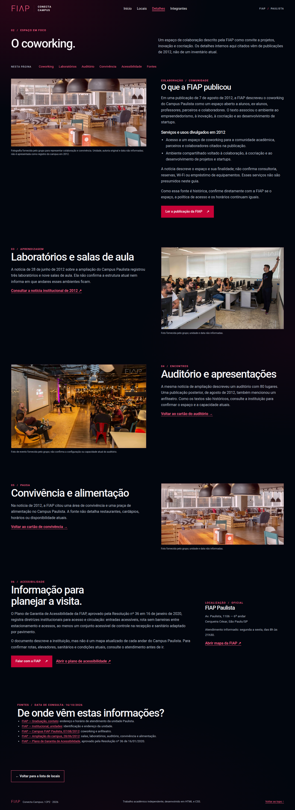
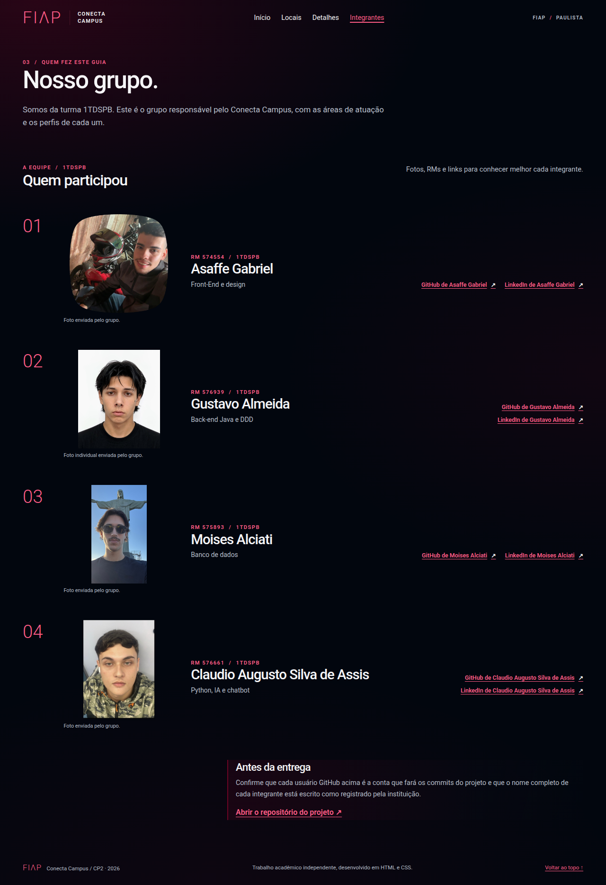

# Conecta Campus FIAP

**Checkpoint 2 · Turma 1TDSPB · 2026**

- Repositório: [gtzall/conecta-campus-fiap-html-css](https://github.com/gtzall/conecta-campus-fiap-html-css)
- Unidade: **FIAP Paulista — Av. Paulista, 1106, São Paulo/SP**
- O site não está publicado. Para visualizar, abra `index.html` no navegador.

## Sobre

O Conecta Campus é um guia estudantil da unidade FIAP Paulista, com informações sobre locais, detalhes dos espaços e integrantes da equipe. O site é estático e usa **HTML e CSS**, sem Python, JavaScript, framework, backend ou banco de dados.

## Páginas

- `index.html` — apresentação e destaques.
- `locais.html` — diretório de espaços, com categoria, localização, informação útil, imagem e link.
- `detalhes.html` — informações sobre espaços, acessibilidade e fontes, com atalhos internos.
- `integrantes.html` — fotos, RMs, turma, papéis e perfis dos integrantes.

## Capturas

| Início | Locais |
| --- | --- |
|  |  |

| Detalhes | Integrantes |
| --- | --- |
|  |  |

## Estrutura

```text
conecta-campus-fiap-html-css/
├── index.html
├── locais.html
├── detalhes.html
├── integrantes.html
├── cp2.txt
├── README.md
├── css/style.css
├── img/                  # Imagens e fotos usadas no site
├── fonts/                # Roboto e licença
└── docs/
    ├── equipe/           # Miniaturas da tabela deste README
    └── prints/           # Capturas das páginas
```

## Integrantes

| Foto | Nome | RM | Turma | Área informada | Perfis |
| --- | --- | --- | --- | --- | --- |
|  | Asaffe Gabriel | 574554 | 1TDSPB | Front-End e design | [GitHub](https://github.com/Asaffeggmsmfj) · [LinkedIn](https://www.linkedin.com/in/asaffe-gabriel-bb4288302) |
|  | Gustavo Almeida | 576939 | 1TDSPB | Back-end Java e DDD | [GitHub](https://github.com/gtzall) · [LinkedIn](https://www.linkedin.com/in/gustavo-almeida-rodrigues) |
|  | Moises Alciati | 575893 | 1TDSPB | Banco de dados | [GitHub](https://github.com/moisesalciati) · [LinkedIn](https://www.linkedin.com/in/moises-de-oliveira-alciati-08a944441) |
|  | Claudio Augusto Silva de Assis | 576661 | 1TDSPB | Python, IA e chatbot | [GitHub](https://github.com/claudiosilva06) · [LinkedIn](https://www.linkedin.com/in/claudio-augusto-b7660a433) |

As áreas acima foram informadas pelo grupo e não representam tecnologias usadas pelo site. Endereço e horário vêm do contato oficial da FIAP; alguns dados de espaços são de publicações de 2012 e estão marcados como históricos. As fotos dos espaços e da equipe foram fornecidas pelo grupo. A Roboto local inclui a licença em `fonts/roboto-ofl.txt`.

## Fontes

- [FIAP — Contato da graduação](https://www.fiap.com.br/graduacao/contato/)
- [FIAP — Campus Paulista, 7 ago. 2012](https://www.fiap.com.br/2012/08/07/campus-fiap-paulista/)
- [FIAP — Ampliação do campus, 28 jun. 2012](https://www.fiap.com.br/imprensa/fiap-inaugura-novo-campus-na-avenida-paulista/)
- [Plano de Garantia de Acessibilidade da FIAP](https://www.fiap.com.br/wp-content/themes/fiap2016/documents/fiap/informacoes-academicas/politicas-institucionais/PLANO%20DE%20GARANTIA%20DE%20ACESSIBILIDADE.pdf)

## Histórico e entrega

Este repositório começa com um único commit de importação do snapshot do site. Isso não substitui a exigência acadêmica de pelo menos 20 commits reais e dois commits feitos por cada integrante em sua própria conta; a equipe ainda precisa registrar contribuições substantivas, sem dividir alterações artificialmente. Por ser privado, a rubrica também pede conceder acesso ao professor `alecarlosjesus`; confirme essa permissão antes da entrega. O líder envia `cp2.txt` no Teams.
